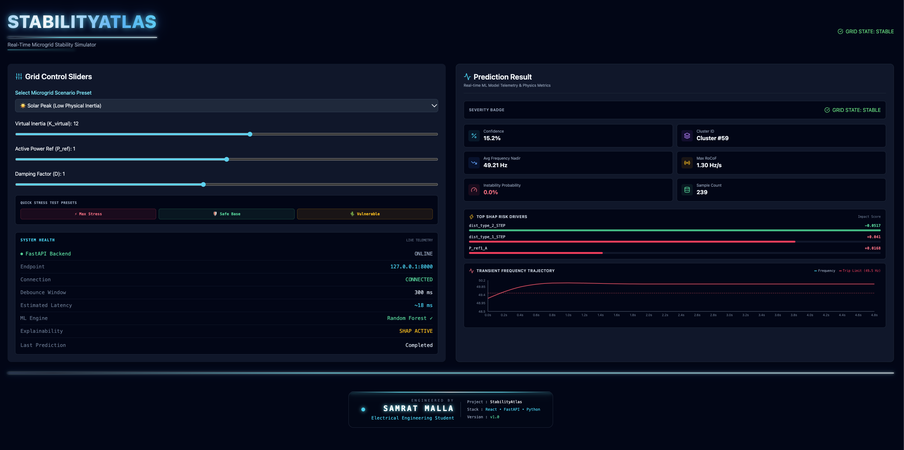
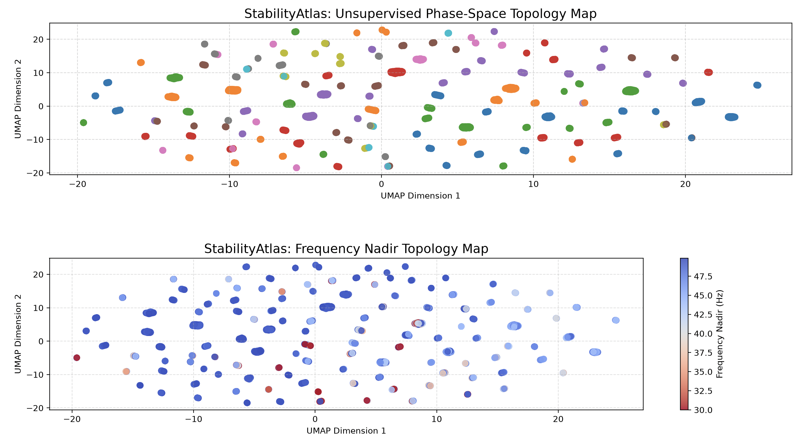
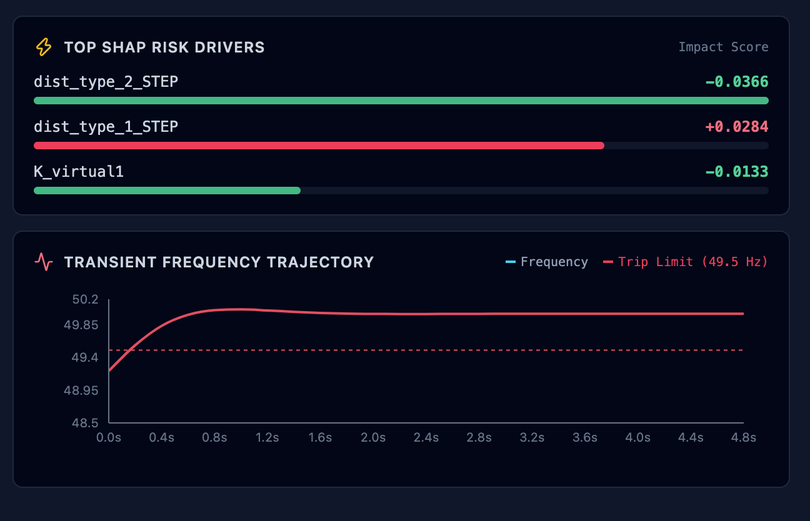
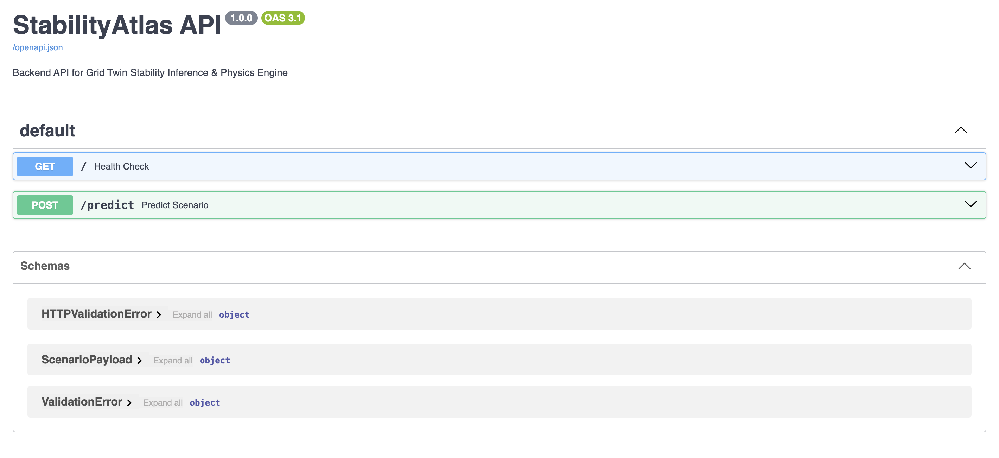

# StabilityAtlas


#### ~ By Samrat Malla | Electrical Engineering Student

---

#  Project Preview
### *An End-to-End Physics Informed AI Platform for Low-Inertia Grid Stability Prediction*

[](https://stabilityatlas.vercel.app/)

[▶ **Watch Live Demo**](https://github.com/user-attachments/assets/aea88aec-609a-432f-8c7c-7d24a4c2a22b)


---

#  Overview

As renewable energy sources replace conventional synchronous generators, modern electrical grids are becoming increasingly **low-inertia**, making them significantly more vulnerable to frequency instability following disturbances.

**StabilityAtlas** bridges the gap between **power system simulation** and **artificial intelligence** through a complete end-to-end workflow that:

- Simulates thousands of realistic power grid scenarios
- Generates physically consistent transient responses
- Learns hidden operating regions using machine learning
- Visualizes grid behavior through clustering
- Provides real-time stability prediction through an interactive web application

Rather than relying solely on historical datasets, StabilityAtlas generates its own synthetic power system data using a custom-built physics engine, enabling exploration of operating conditions that may never have occurred in reality.

---

#  Features

-  Custom 11-State Dynamic Power System Simulator
-  Two-Area Multi-Generator Grid Model
-  Battery Energy Storage with Bidirectional Fast Frequency Response (FFR)
-  Tie-Line Interconnection Dynamics
-  Five Realistic Grid Operating Environments
-  Multiple Dynamic Disturbance Profiles
-  UMAP Dimensionality Reduction
-  HDBSCAN Stability Clustering
-  Random Forest Cluster Classification
-  SHAP Explainable AI
-  FastAPI Backend
-  React Dashboard
-  Cloud Deployment Ready

---

#  Project Architecture

```text
Grid Physics Engine
        │
        ▼
10,000 Dynamic Simulations
        │
        ▼
Feature Extraction
        │
        ▼
UMAP Dimension Reduction
        │
        ▼
HDBSCAN Clustering
        │
        ▼
Random Forest Classifier
        │
        ▼
FastAPI Backend
        │
        ▼
React Dashboard
```

---

#  Physics Engine

At the heart of StabilityAtlas lies a custom-built dynamic simulation engine.

The simulator models:

- Two interconnected control areas
- Four synchronous generators
- Governor dynamics
- Automatic Generation Control (AGC)
- Battery-based Fast Frequency Response
- Tie-line power exchange
- Dynamic electrical disturbances

The simulator solves an **11-state nonlinear differential equation system** using SciPy's adaptive RK45 numerical solver.

Each simulation generates a complete **30-second transient response**, from which stability metrics are extracted.

---

#  Scenario Generation

Every simulation begins by randomly generating a realistic operating environment.

Supported scenarios include:

-  Solar Peak Low Inertia
-  Night Low Demand
-  Heavy Industrial Inertia
-  Renewable Drought
-  Extreme Storm Contingency

Each environment randomly varies:

- Generator inertia
- Virtual inertia
- Battery capacity
- Damping coefficient
- Initial battery state-of-charge
- Disturbance magnitude
- Governor parameters

Creating thousands of unique yet physically meaningful operating conditions.

---

#  Disturbance Modeling

The simulator supports multiple disturbance profiles:

- STEP
- RAMP
- PULSE
- CASCADE
- NOISY STEP

Each disturbance is randomly parameterized to emulate realistic power system events.

---

#  Feature Engineering

Each simulation produces a rich feature vector including:

- Frequency nadirs
- Maximum RoCoF
- Battery SoC variation
- Tie-line utilization
- Generator parameters
- Controller settings
- Operating environment
- Disturbance type

A total of **64 engineered features** are generated for machine learning.

---

#  Machine Learning Pipeline

```text
Physics Simulation
        │
        ▼
Feature Extraction
        │
        ▼
UMAP
        │
        ▼
HDBSCAN
        │
        ▼
Random Forest
        │
        ▼
SHAP Explainability
```

Instead of directly predicting stability, StabilityAtlas first discovers **natural operating regions** using unsupervised learning before training a Random Forest classifier for real-time prediction.

---

#  Risk Classification

Each operating cluster is evaluated using three physical stability indicators:

- Average Frequency Nadir
- Instability Rate
- Maximum Rate of Change of Frequency (RoCoF)

These metrics are combined into a weighted **Risk Score**, allowing every cluster to be classified as:

-  **Green Safe**
-  **Yellow Warning**
-  **Red Critical**

---

#  Interactive Dashboard

 

The React frontend allows users to:

- Adjust grid parameters
- Configure disturbances
- Run real-time predictions
- View confidence scores
- Explore SHAP feature importance
- Understand why the AI reached its prediction

Predictions are served through a FastAPI backend.

---

#  Technology Stack

## Frontend

- React
- Vite
- CSS

## Backend

- FastAPI
- Uvicorn

## Machine Learning

- Scikit-learn
- UMAP
- HDBSCAN
- SHAP

## Scientific Computing

- NumPy
- SciPy
- Pandas

## Deployment

- Render
- Vercel

---

#  Repository Structure

```text
StabilityAtlas/
│
├── backend/
├── frontend/
├── data/
├── assets/
├── README.md
```

---

#  Gallery

## UMAP Stability Map



---

## React Dashboard


---

## SHAP Explainability



---

## FastAPI Swagger API



---

#  Future Improvements

- Interactive UMAP Cluster Explorer
- Frequency Response Visualization
- Multi-Area Power System Simulation
- PMU-Based Real-Time Monitoring
- Reinforcement Learning Controllers
- Digital Twin Integration
- GPU-Accelerated Simulation

---

#  Motivation

StabilityAtlas was developed as a personal research project exploring the intersection of:

- Power System Dynamics
- Low-Inertia Electrical Grids
- Automatic Generation Control
- Battery Energy Storage Systems
- Numerical Simulation
- Explainable Artificial Intelligence
- Machine Learning
- Full-Stack Development

The project demonstrates how modern AI techniques can complement traditional power system stability analysis by transforming complex simulation outputs into intuitive, real-time engineering insights.

---

#  Contact

If you'd like to discuss the project, collaborate, provide feedback, or simply connect, feel free to reach out!

📧 **Email:** samratmalla2062@gmail.com

🌐 **Portfolio:** https://heysammy.framer.wiki

---

#  Support

If you found this project interesting or helpful, consider giving it a ⭐ on GitHub!

---
